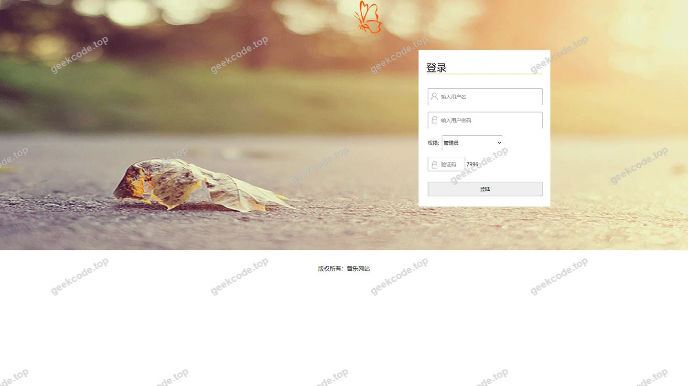
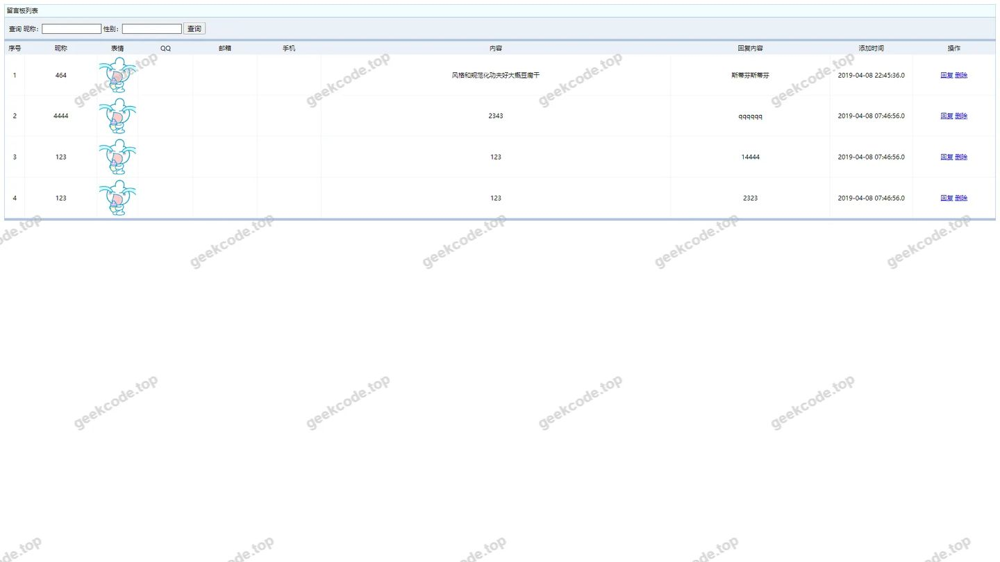
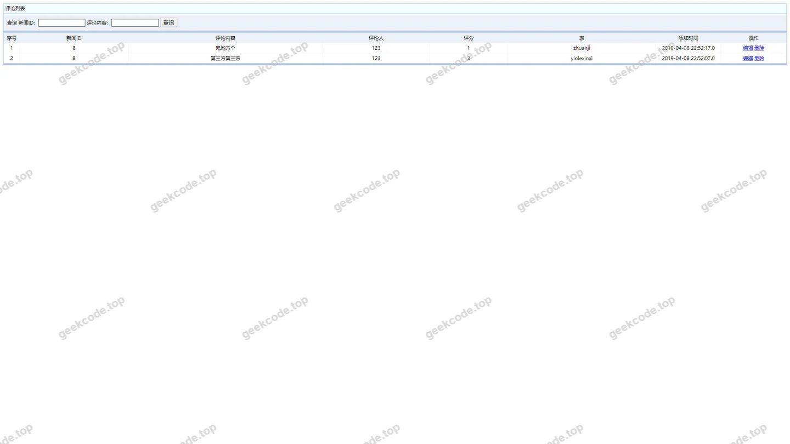
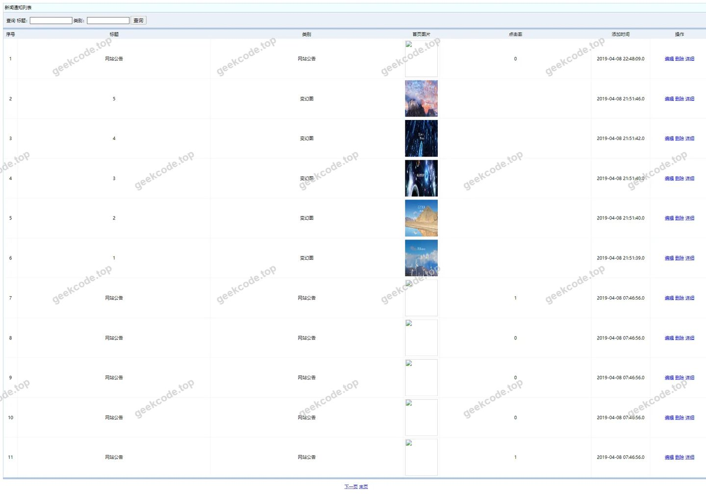
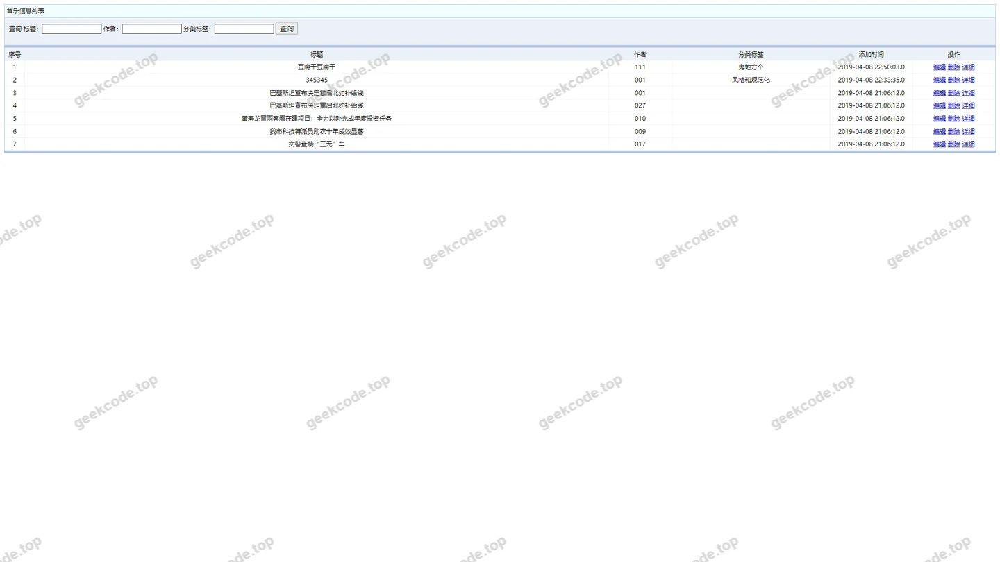
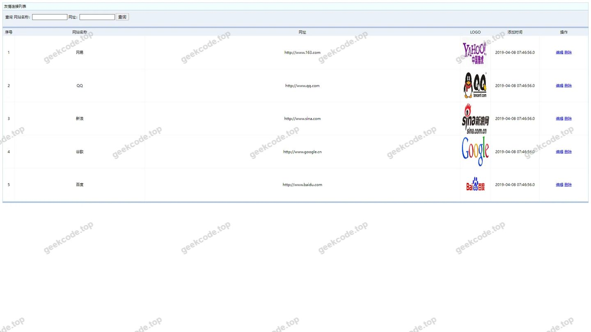
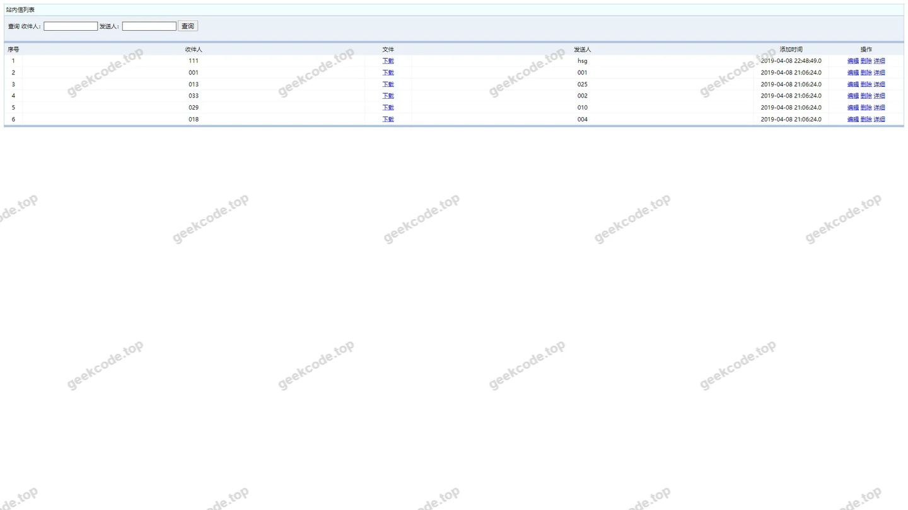
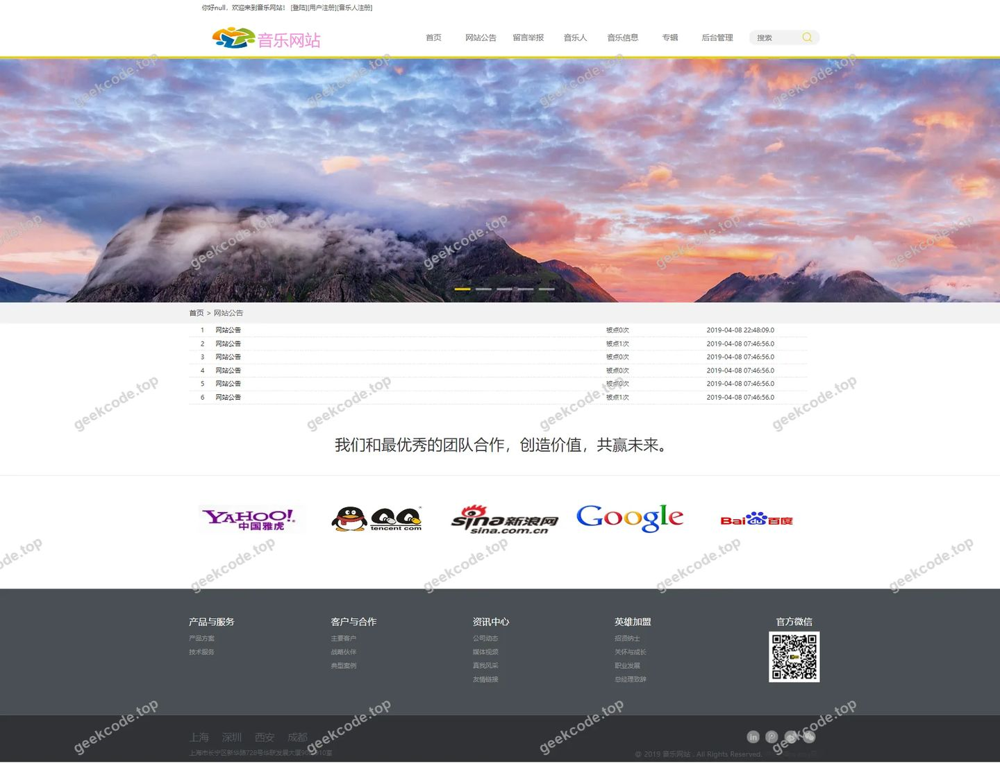
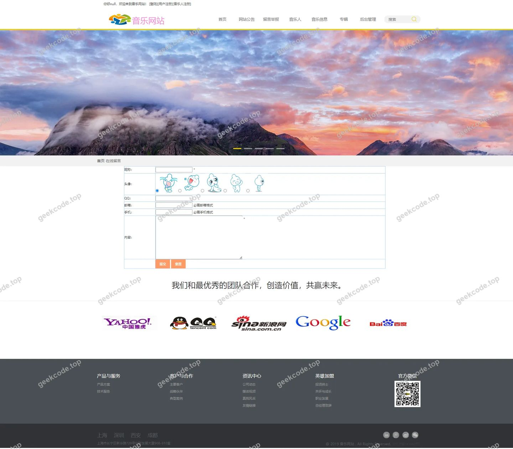
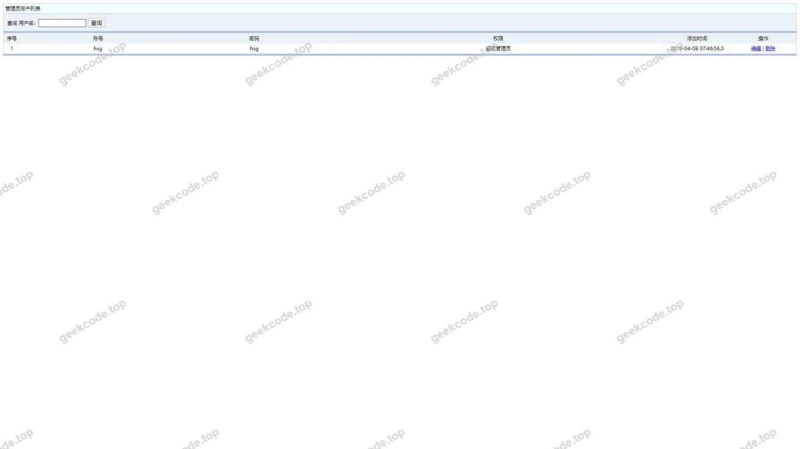

# ssm音乐网站(1)

> 🎓 **计算机毕业设计 · ssm音乐网站(1)**
>
> 本仓库只放**项目介绍 + 运行截图**（截图是站点带水印的原图，存在仓库 `images/` 里）。
>
> 👉 **完整可运行源码 / 数据库脚本 / 部署文档：[点我获取](https://geekcode.top/archives/ssm%E9%9F%B3%E4%B9%90%E7%BD%91%E7%AB%99-1?utm_source=github)**
>
> 💬 咨询微信：**ir9372**　|　🌐 更多项目：[极客代码 geekcode.top](https://geekcode.top/?utm_source=github)
>
> 📌 项目详情页：<https://geekcode.top/archives/ssm%E9%9F%B3%E4%B9%90%E7%BD%91%E7%AB%99-1?utm_source=github>

<table><td width="230" align="center"> <b>扫码加微信 ir9372</b></td><td valign="middle">📦 源码 = 项目介绍 + 全部运行截图 + 数据库 + 部署文档 👉 点上方任意截图，直接跳到 <b>极客代码 geekcode.top</b> 详情页</td></table>

---

<h1>ssm音乐网站(1)</h1>
<h2>项目概述</h2>

本项目为基于 SSM（Spring + Spring MVC + MyBatis）框架与 JSP 技术构建的音乐网站系统。尽管元数据标记无前台/后台，但根据截图列表分析，该系统实际上包含面向普通用户和音乐人的前端展示页面，以及面向管理员的后台管理界面。核心功能涵盖音乐信息浏览、专辑管理、独立音乐人展示、用户注册登录、留言互动、收藏记录及新闻通知等模块。系统旨在搭建一个集音乐发布、欣赏与交流于一体的平台，服务于音乐爱好者、独立音乐人及网站运营管理员。通过分层架构设计，实现业务逻辑与数据访问的有效分离，确保系统的可维护性与扩展性。

<h2>技术架构</h2>
<h3>后端架构</h3>

采用经典的 Java Web 三层架构：

<ul>
<li><strong>表现层</strong>：使用 JSP 作为视图模板，结合 Spring MVC 控制器处理 HTTP 请求与响应。</li>
<li><strong>业务逻辑层</strong>：由 Spring Framework 负责依赖注入（DI）和面向切面编程（AOP），封装核心业务规则。</li>
<li><strong>数据持久层</strong>：利用 MyBatis 框架进行 SQL 映射，实现对象关系映射（ORM），直接操作 MySQL 数据库。</li>
</ul>
<h3>前端架构</h3>

基于原生 HTML/CSS/JavaScript 开发，通过 JSP 标签库动态渲染数据。页面结构包括系统首页、各类列表页（如音乐信息、专辑、用户列表等）及管理后台页面。未检测到 Vue/React 等现代前端框架的使用，符合传统 SSM+JSP 的技术栈特征。

<h3>数据库设计要点</h3>

根据实体类命名推断，数据库主要包含以下核心表结构：

<ul>
<li><code>allusers</code> / <code>yonghuzhuce</code>：存储普通注册用户信息。</li>
<li><code>duliyinleren</code> / <code>dlylr</code>：存储独立音乐人信息及作品关联。</li>
<li><code>yinlexinxi</code> / <code>ylxx</code>：存储音乐曲目详情（标题、歌手、时长等）。</li>
<li><code>zhuanji</code> / <code>zj</code>：存储专辑信息。</li>
<li><code>liuyanban</code> / <code>lyb</code>：存储留言板内容。</li>
<li><code>pinglun</code>：存储对音乐或文章的评论数据。</li>
<li><code>shoucangjilu</code>：存储用户的收藏记录。</li>
<li><code>xinwentongzhi</code>：存储网站新闻与通知公告。</li>
<li><code>youqinglianjie</code>：存储友情链接配置。</li>
<li><code>zhanneixin</code>：存储站内信消息。</li>
</ul>
<h3>核心技术选型理由</h3>

选择 SSM 组合是因为其在当时 Java Web 开发中具有成熟度高、生态丰富、文档完善的优势。MyBatis 提供了灵活的 SQL 控制能力，适合复杂查询场景；Spring MVC 清晰的路由机制便于前后端交互；JSP 虽较为传统，但在服务端渲染模式下能简化静态资源部署流程，适合毕业设计级别的快速开发与演示。

<h2>功能模块</h2>
<h3>前台用户端功能</h3>
<ol>
<li><strong>系统首页</strong>：展示最新音乐、热门专辑、网站公告及推荐内容。</li>
<li><strong>音乐信息浏览</strong>：查看 <code>yinlexinxi</code> 列表，支持按类别筛选，展示歌曲详细信息。</li>
<li><strong>专辑管理</strong>：查看 <code>zhuanji</code> 列表，浏览特定歌手的专辑合集。</li>
<li><strong>独立音乐人专区</strong>：展示 <code>duliyinleren</code> 列表，介绍音乐人简介及其代表作品。</li>
<li><strong>用户注册与登录</strong>：提供 <code>yonghuzhuce</code> 入口，新用户需填写基本信息完成注册；已有账号可进行登录验证。</li>
<li><strong>留言互动</strong>：<ul>
<li><strong>留言板</strong>：查看 <code>liuyanban</code> 历史留言，提交新留言。</li>
<li><strong>评论系统</strong>：针对具体音乐或文章发表 <code>pinglun</code>。</li>
</ul>
</li>
<li><strong>收藏功能</strong>：用户对喜欢的音乐或专辑进行收藏，生成 <code>shoucangjilu</code> 记录，可在个人中心查看。</li>
<li><strong>资讯获取</strong>：阅读 <code>xinwentongzhi</code> 发布的网站新闻与通知。</li>
<li><strong>站内信</strong>：接收并查看 <code>zhanneixin</code> 发送的系统消息或个人消息。</li>
<li><strong>友情链接</strong>：在底部导航栏展示 <code>youqinglianjie</code> 配置的合作伙伴链接。</li>
</ol>
<h3>后台管理端功能</h3>
<ol>
<li><strong>管理员登录</strong>：通过 <code>[登陆]</code> 页面进入管理系统。</li>
<li><strong>用户管理</strong>：<ul>
<li>查看所有注册用户列表 (<code>allusers</code>)。</li>
<li>审核或管理独立音乐人账户 (<code>dlylr</code>)。</li>
<li>执行用户注册相关操作 (<code>[用户注册]</code>, <code>[音乐人注册]</code>)。</li>
</ul>
</li>
<li><strong>内容管理</strong>：<ul>
<li><strong>音乐信息管理</strong>：增删改查 <code>ylxx</code> 中的音乐条目。</li>
<li><strong>专辑管理</strong>：维护 <code>zj</code> 中的专辑数据。</li>
<li><strong>新闻通知管理</strong>：发布和管理 <code>xinwentongzhi</code> 内容。</li>
<li><strong>留言管理</strong>：审核 <code>lyb</code> 中的用户留言，删除违规内容。</li>
<li><strong>评论管理</strong>：监控 <code>pinglun</code> 数据，清理恶意评论。</li>
<li><strong>收藏记录查看</strong>：审计 <code>shoucangjilu</code> 以分析用户偏好。</li>
</ul>
</li>
<li><strong>系统设置</strong>：<ul>
<li>管理 <code>youqinglianjie</code> 友情链接。</li>
<li>发送 <code>zhanneixin</code> 站内信。</li>
<li>查看特定管理员操作日志或配置文件（如截图所示的“司宪策”可能指代某项策略配置或特定管理员视角页面）。</li>
</ul>
</li>
</ol>
<h2>用户角色与权限</h2>
<table>
<thead>
<tr>
<th align="left">角色</th>
<th align="left">描述</th>
<th align="left">可访问功能模块</th>
</tr>
</thead>
<tbody><tr>
<td align="left"><strong>游客</strong></td>
<td align="left">未登录的访问者</td>
<td align="left">浏览首页、查看音乐列表、查看专辑、查看独立音乐人、阅读新闻、查看留言板（只读）、点击注册/登录链接。</td>
</tr>
<tr>
<td align="left"><strong>普通用户</strong></td>
<td align="left">已注册的听众</td>
<td align="left">游客所有权限 + 个人收藏管理 (<code>shoucangjilu</code>)、发表评论 (<code>pinglun</code>)、提交留言 (<code>liuyanban</code>)、接收站内信 (<code>zhanneixin</code>)、修改个人资料。</td>
</tr>
<tr>
<td align="left"><strong>独立音乐人</strong></td>
<td align="left">已认证的内容创作者</td>
<td align="left">普通用户所有权限 + 上传/管理自己的音乐作品 (<code>yinlexinxi</code>)、创建/编辑个人专辑 (<code>zhuanji</code>)、查看粉丝收藏数据、回复评论。</td>
</tr>
<tr>
<td align="left"><strong>管理员</strong></td>
<td align="left">系统运维人员</td>
<td align="left">全系统权限。包括：用户管理 (allusers, dlylr)、内容审核与发布 (ylxx, zj, xinwentongzhi)、互动管理 (lyb, pinglun)、系统配置 (youqinglianjie, zhanneixin)、数据监控。</td>
</tr>
</tbody></table>

<em>注：根据截图 <code>[admin]</code> 标识，部分页面如“我要留言”、“网站公告”等在后台可见，表明管理员拥有最高权限，可模拟用户行为或直接管理这些模块的数据源。</em>

<h2>项目特色与创新点</h2>
<ol>
<li><strong>垂直领域聚焦</strong>：不同于通用博客或电商系统，本项目专门针对“音乐分享”场景，设计了独立的音乐人 (<code>duliyinleren</code>) 和专辑 (<code>zhuanji</code>) 实体，体现了对音乐版权和艺人关系的结构化思考。</li>
<li><strong>互动闭环设计</strong>：集成了留言板、评论、收藏和站内信四大互动模块，构建了从“发现音乐”到“表达喜爱”再到“深度交流”的用户参与闭环。</li>
<li><strong>多角色协同体系</strong>：明确区分了普通听众、内容生产者（音乐人）和平台管理者三种角色，权限隔离清晰，保障了社区内容的有序性和专业性。</li>
<li><strong>传统稳健架构</strong>：采用成熟的 SSM+JSP 技术栈，虽然非前沿微服务架构，但对于单体应用而言，其事务管理、MVC 分层和数据映射方案极为稳定，易于理解和维护，适合作为计算机专业基础能力的综合体现。</li>
</ol>
<h2>部署环境</h2>

为确保项目正常运行，需准备以下软件环境：

<ul>
<li><strong>操作系统</strong>：Windows 7/10/11 或 Linux (CentOS/Ubuntu)</li>
<li><strong>Java 运行环境</strong>：JDK 1.8 (推荐)</li>
<li><strong>Web 服务器</strong>：Apache Tomcat 8.5 或 9.0</li>
<li><strong>数据库</strong>：MySQL 5.7 或 8.0</li>
<li><strong>开发工具</strong>：IntelliJ IDEA 或 Eclipse (配合 Maven 插件)</li>
<li><strong>浏览器</strong>：Chrome, Firefox, Edge 等主流现代浏览器</li>
</ul>

<strong>部署步骤简述：</strong>

<ol>
<li>安装 JDK 并配置环境变量。</li>
<li>安装 MySQL，创建数据库并导入项目提供的 <code>.sql</code> 脚本文件。</li>
<li>修改项目中 <code>jdbc.properties</code> 或类似配置文件，填入正确的数据库 URL、用户名和密码。</li>
<li>配置 Tomcat 服务器路径。</li>
<li>将项目打包为 WAR 包或直接在 IDE 中部署至 Tomcat。</li>
<li>启动 Tomcat，访问 <code>http://localhost:8080/[项目名]/index.jsp</code> 进行测试。</li>
</ol>
<h2>五、技术特性</h2>
<ul>
<li>服务端模板渲染（JSP）</li>
</ul>
<h2>六、功能模块截图</h2>
<h3>前台用户端</h3>
<h4>登录页</h4>

<h4>页面-duliyinleren列表</h4>

<h4>页面-dlylr列表</h4>

<h4>页面-liuyanban列表</h4>

<h4>页面-lyb列表</h4>

<h4>页面-pinglun列表</h4>

<h4>页面-shoucangjilu列表</h4>

<h4>页面-xinwentongzhi列表</h4>

<h4>页面-yinlexinxi列表</h4>

<h4>页面-ylxx列表</h4>

<h4>页面-yonghuzhuce列表</h4>

<h4>页面-youqinglianjie列表</h4>

<h4>页面-zhanneixin列表</h4>

<h4>页面-zhuanji列表</h4>

<h4>页面-zj列表</h4>

<h4>页面-系统首页</h4>

<h4>页面-[登陆]</h4>

<h4>页面-[用户注册]</h4>

<h4>页面-[音乐人注册]</h4>

<h4>页面-网站公告</h4>

<h4>页面-我要留言</h4>

<h4>页面-司宪策</h4>

<h3>后台管理端</h3>
<h4>页面-allusers列表</h4>

---

## 获取完整源码

| 项目 | 说明 |
| --- | --- |
| 项目名 | ssm音乐网站(1) |
| 运行截图 | 本文 20 张（站点带水印原图，仓库 `images/` 目录） |
| 完整源码 | [https://geekcode.top/archives/ssm%E9%9F%B3%E4%B9%90%E7%BD%91%E7%AB%99-1?utm_source=github](https://geekcode.top/archives/ssm%E9%9F%B3%E4%B9%90%E7%BD%91%E7%AB%99-1?utm_source=github) |
| 咨询微信 | **ir9372**（备注：jingpin-yuanma） |
| 更多项目 | [极客代码 geekcode.top](https://geekcode.top/?utm_source=github) |

> 需要源码、部署、改配置、跑不起来等问题，加微信 ir9372 沟通，说明项目名即可。
